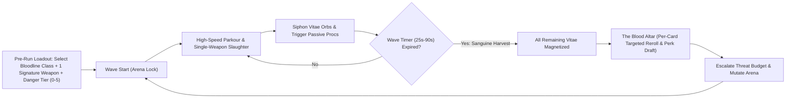
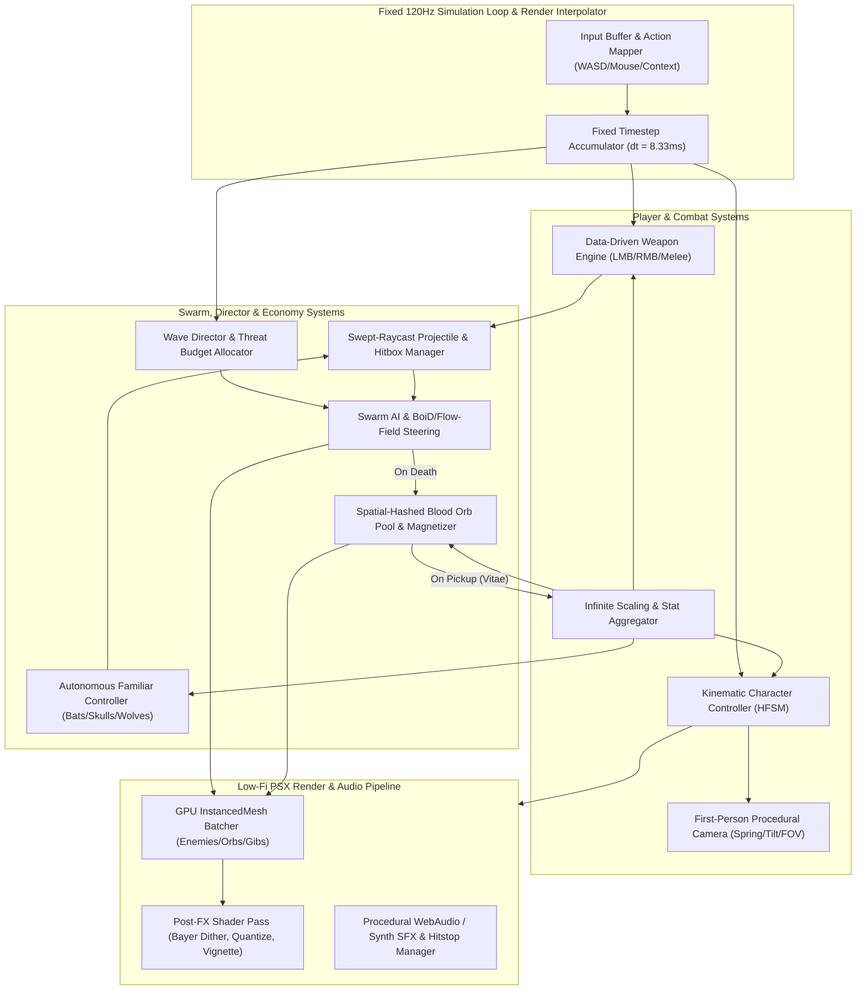
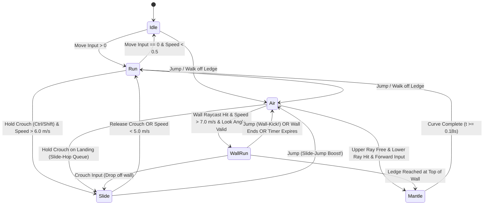
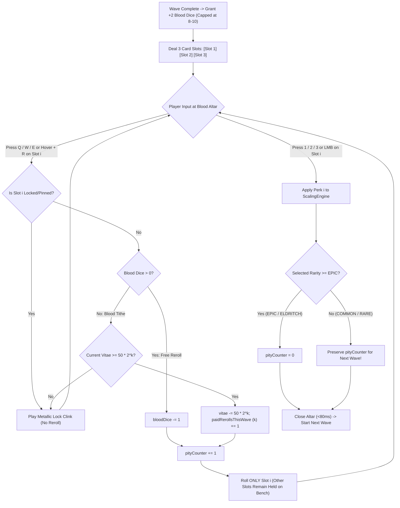

# SANGUINE_RUNNER — Architecture & Game Design Document (GDD)

> **Project Codename:** `SANGUINE_RUNNER` (`sanguine-runner`)  
> **Genre:** 1st-Person Movement Roguelike Arena Shooter  
> **Design North Star:** *Ultrakill* + *DUSK* + *Ghostrunner* kinetic lethality fused with *Brotato* wave-based roguelike arena escalation  
> **Aesthetic Direction:** Brutalist Gothic Low-Poly (PSX / Boomer-Shooter) — *Hellsing Ultimate* (Alucard), *Vampire Hunter D: Bloodlust*, *Castlevania: Symphony of the Night*  
> **Target Performance:** Locked 120+ FPS physics & rendering, zero asset bloat, sub-second iteration time  
> **Version Control Rule:** **Fă un commit pe GitHub la fiecare checkpoint sub proiectul `sanguine-runner`** (`https://github.com/PatrickRucarean/sanguine-runner.git` — cont: `PatrickRucarean` / `prucarean@gmail.com`)  

---

## 0. Executive Vision & Core Fantasy

In **`SANGUINE_RUNNER`**, you are not a fragile survivor hiding in the shadows—you are an ancient, arrogant, hyper-lethal apex vampire lord awakened inside a brutalist occult cathedral-slaughterhouse. You do not duck behind cover; **motion is your armor, and arterial bloodshed is your ammunition, health, and currency.**

### Core Gameplay Loop


### The Four Unbreakable Rules of `SANGUINE_RUNNER`
1. **Speed Is Life:** Standing still for more than 400ms in Wave 5+ is a death sentence. High horizontal velocity grants passive **Evasion / Grazing Mitigation** and feeds weapon momentum multipliers.
2. **Single-Weapon Run & Decoupled Bloodline Loadouts:** There is **no multi-weapon inventory, no mid-run weapon swapping, and no Tier 1–5 weapon merging**. Before Wave 1, the player picks a **Character / Bloodline** (stat offsets & unique passive) and **one Signature Weapon** from that character's allowed starting pool (2–3 weapons per class). That single weapon is carried until the end of the run and mutates into a god-slaying instrument exclusively through infinite passive stacking (`+dmg`, `+bleed`, `+pierce`, `+melee_reach_multiplier`) and proc synergies.
3. **Zero Hotkey Bloat:** Every active combat verb lives on **WASD, Space, Shift/Ctrl, LMB (Primary), RMB (Weapon Alt-Fire / Sanguine Technique), F (Context Quick Melee / Slide Blood-Kick / Execution), and R (Active Blood Reload / Flourish)**. There are no `1-2-3-4-5` cooldown bars.
4. **Readable Brutalist Chaos:** Environments are stark, monolithic, monochromatic brutalist stone and iron. Enemies, projectiles, and blood bursts are rendered in high-contrast **Arterial Crimson (`#E60012`)**, **Hellfire Orange (`#FF4500`)**, and **Occult Gold (`#FFD700`)** so the player can read 150+ simultaneous threats at 30 m/s.

---

## 1. System Overview & Technology Stack Recommendation

### 1.1 Engine & Framework Evaluation

To achieve rapid prototype iteration, zero external asset dependency (procedural/primitive low-poly meshes + vertex/fragment shaders), and rock-solid 120+ FPS deterministic physics, we evaluate the two primary candidate stacks:

| Criterion | Option A: WebGL2 / WebGPU (`Three.js` + `Rapier3D` WASM + `TypeScript` + `Vite`) | Option B: Native Engine (`Godot 4.3+` with `Jolt Physics` + `GDScript` / `C#`) |
| :--- | :--- | :--- |
| **Iteration Speed** | **Instant (<100ms HMR)**. Code-first architecture with zero binary scene serialization conflicts. | Fast (1–3s launch), requires Godot Editor / CLI binary installed and `.tscn`/`.tres` management. |
| **Physics Determinism & Speed** | **`@dimforge/rapier3d`** runs in SIMD-accelerated Rust/WASM. Handles 500+ rigidbodies/raycasts at <1.2ms per tick. | **Godot Jolt** is high-performance native C++, miles ahead of default GodotPhysics. |
| **Low-Fi Shader Pipeline** | Custom `EffectComposer` post-processing pass (Bayer Dither, Color Quantization, Chromatic Aberration) in <150 lines of GLSL. | Godot `CanvasItem` / Spatial screen-space shaders; easy to write, slightly more boilerplate to wire multi-pass buffers. |
| **Object Pooling & ECS** | Pure TypeScript TypedArrays (`Float32Array`) + `THREE.InstancedMesh` draws 5,000 Blood Orbs and 300 enemies in **2 draw calls**. | `MultiMeshInstance3D` + custom node pooling or C# structs. GDScript object overhead can bottleneck at 1,000+ active projectiles/orbs. |
| **AI-Assisted Code Generation** | **100% self-contained text files** (`.ts`, `.json`, `.glsl`). Zero opaque binary assets required to build and play immediately. | Requires `.godot` project config, binary/text `.tscn` hierarchy coordination, and local engine installation. |

### 1.2 Primary Architectural Recommendation: **TypeScript + Three.js + Rapier3D (WASM) + Bitecs/TypedArray Data Store**
*(With direct 1:1 structural parity for porting to Godot 4.x `CharacterBody3D` + `MultiMeshInstance3D`)*

For rapid, code-driven development in this repository, **Three.js + `@dimforge/rapier3d-compat` + Vite + TypeScript** is the optimal primary implementation stack:
1. **Zero-Asset Procedural Brutalism:** Weapons, gothic pillars, cathedrals, enemies, and familiars can be constructed algorithmically via CSG/low-poly buffer geometries with flat-shaded vertex colors and procedural textures—meaning the game runs out-of-the-box with `npm run dev` without waiting on Blender asset pipelines.
2. **Fixed-Timestep Decoupled Loop:** Physics and combat logic execute on a strict **120 Hz fixed timestep (`dt = 1 / 120 = 8.333ms`)** accumulator loop, while rendering interpolates transforms smoothly at the monitor's native refresh rate (60–240+ Hz).
3. **Hybrid ECS / Data-Oriented Architecture:**
   - **Player & Weapons:** Explicit Hierarchical Finite State Machines (HFSM) for tactile, frame-exact responsiveness.
   - **Swarm Enemies, Projectiles, Particles, & Blood Orbs:** Struct-of-Arrays (SoA) backed by pre-allocated `Float32Array` / `Int32Array` buffers and rendered via `THREE.InstancedMesh`, eliminating garbage collection (GC) pauses during Wave 20+ bullet-hell storms.

### 1.3 High-Level System Architecture Diagram



---

## 2. Kinematic Controller Architecture

The player controller is a **Custom Raycast/Shape-Cast Kinematic Character Controller (KCC)** using a capsule collider ($r = 0.4\text{ m}$, $h = 1.8\text{ m}$ standing, $h = 0.9\text{ m}$ sliding). We do **not** use a dynamic rigidbody with standard physics engine friction; all velocity integration, stair-stepping, slope projection, and air-strafing are calculated explicitly to guarantee *Quake III* / *Ultrakill* / *Ghostrunner* responsiveness.

### 2.1 Movement State Machine (HFSM)



#### State Definitions & Entry/Exit Invariants

| State | Collider Height | Camera Eye Height | Key Rules & Invariants |
| :--- | :---: | :---: | :--- |
| **`IDLE`** | $1.80\text{ m}$ | $1.65\text{ m}$ | High ground deceleration ($f = 14.0\text{ s}^{-1}$). Instant zeroing below $0.2\text{ m/s}$ to prevent micro-drift. |
| **`RUN`** | $1.80\text{ m}$ | $1.65\text{ m}$ | Base speed $12.5\text{ m/s}$. Snappy ground acceleration ($a = 15.0\text{ s}^{-1}$). Preserves overspeed for $100\text{ ms}$ (bhop window). |
| **`SLIDE`** | $0.90\text{ m}$ | $0.75\text{ m}$ | Triggered when horizontal speed $\|\mathbf{v}_{xz}\| \ge 6.0\text{ m/s}$. Camera rolls $4.5^\circ$. Grants **Slide Blood-Kick** hitbox on front capsule. |
| **`AIR`** | $1.80\text{ m}$ | $1.65\text{ m}$ | Zero ground friction. Quake/Source dot-product air-strafing enabled. Coyote time ($120\text{ ms}$) and Jump Buffer ($120\text{ ms}$) active. |
| **`WALL_RUN`** | $1.80\text{ m}$ | $1.65\text{ m}$ | Velocity projected onto wall tangent. Camera tilts $\pm 12^\circ$ away from wall. Resets air-jump/dash charges. |
| **`MANTLE`** | $0.90\text{ m}$ | Interpolated | Non-blocking $180\text{ ms}$ Hermite spline vault over ledges. Preserves forward momentum upon exit (+$3.0\text{ m/s}$ surge). |

---

### 2.2 Exact Physics Formulas & Vector Math

Let $\Delta t = \frac{1}{120}\text{ s}$ be the fixed simulation step. Let $\mathbf{v} = (v_x, v_y, v_z)$ be the player's world-space velocity, and $\mathbf{v}_{xz} = (v_x, 0, v_z)$ be the horizontal velocity vector. Let $\hat{\mathbf{w}}$ be the normalized horizontal wish-direction derived from `WASD` input and camera yaw $\theta_{\text{yaw}}$.

#### A. Ground Friction with Bhop Grace Window
When grounded, friction is **skipped** for the first $2\text{ ticks}$ ($16.6\text{ ms}$) after landing if a buffered jump is queued, enabling lossless bunny-hopping. Otherwise, speed $s = \|\mathbf{v}_{xz}\|$ is reduced before acceleration:

$$s_{\text{control}} = \max(s, v_{\text{stop}})$$

$$s_{\text{new}} = \max\left(0, \; s - s_{\text{control}} \cdot \mu_{\text{ground}} \cdot \Delta t\right)$$

$$\mathbf{v}_{xz} \leftarrow \mathbf{v}_{xz} \cdot \frac{s_{\text{new}}}{s} \quad (\text{if } s > 0)$$

Where:
- $v_{\text{stop}} = 4.0\text{ m/s}$ (ensures crisp stopping at low speeds; zero floaty drift)
- $\mu_{\text{ground}} = 8.5\text{ s}^{-1}$ in `RUN`, $14.0\text{ s}^{-1}$ in `IDLE`

#### B. Ground & Air-Strafe Acceleration (Dot-Product Vector Projection)
To preserve momentum when exceeds base speed $v_{\text{wish}}$ (via bunny-hopping, slide-jumping, or shotgun-jumping), we project the current velocity onto the wish direction $\hat{\mathbf{w}}$:

$$v_{\text{proj}} = \mathbf{v}_{xz} \cdot \hat{\mathbf{w}}$$

$$v_{\text{add}} = v_{\text{wish}} - v_{\text{proj}}$$

If $v_{\text{add}} > 0$:

$$v_{\text{accel}} = \min\left(v_{\text{add}}, \; a_{\text{coeff}} \cdot v_{\text{wish}} \cdot \Delta t\right)$$

$$\mathbf{v}_{xz} \leftarrow \mathbf{v}_{xz} + v_{\text{accel}} \cdot \hat{\mathbf{w}}$$

- **On Ground (`RUN`):** $v_{\text{wish}} = 12.5\text{ m/s} \times M_{\text{speed}}$, $a_{\text{coeff}} = 14.0\text{ s}^{-1}$.
- **In Air (`AIR` — Strafe Logic):**
  - For normal air control along wish vector: $v_{\text{wish, air}} = 12.5\text{ m/s}$, $a_{\text{coeff, air}} = 2.8\text{ s}^{-1}$.
  - For **Air-Strafe Momentum Gain** (when holding A/D and smoothly turning the mouse so $\mathbf{v}_{xz} \cdot \hat{\mathbf{w}} \approx 0$): we evaluate a secondary Quake-style air-strafe pass with $v_{\text{wish, strafe}} = 2.2\text{ m/s}$ and $a_{\text{coeff, strafe}} = 35.0\text{ s}^{-1}$. Because $v_{\text{proj}}$ is near zero when $\hat{\mathbf{w}} \perp \mathbf{v}_{xz}$, each frame adds tangential velocity, curving the trajectory and compounding horizontal speed up to the soft cap.
- **Horizontal Speed Soft Cap:** Above $v_{\text{soft}} = 28.0\text{ m/s} \times M_{\text{speed}}$, air drag applies a quadratic bleed:
  $$\mathbf{v}_{xz} \leftarrow \mathbf{v}_{xz} \cdot \left(1 - 0.85 \cdot \frac{\|\mathbf{v}_{xz}\| - v_{\text{soft}}}{v_{\text{soft}}} \cdot \Delta t\right)$$

#### C. Ground Sliding & Slope Momentum Math
Entering `SLIDE` on flat ground applies an immediate forward impulse along the movement vector $\hat{\mathbf{d}} = \frac{\mathbf{v}_{xz}}{\|\mathbf{v}_{xz}\|}$ (Subject to a $0.65\text{ s}$ slide-boost internal cooldown to prevent macro spam, though **Slide-Jumping** always preserves existing speed):

$$\mathbf{v}_{xz} \leftarrow \mathbf{v}_{xz} + I_{\text{slide}} \cdot \hat{\mathbf{d}}, \quad I_{\text{slide}} = 4.5\text{ m/s}$$

On a surface with normal $\hat{\mathbf{n}} = (n_x, n_y, n_z)$ where $n_y < 1.0$:
1. Compute the downward slope tangent vector:
   $$\mathbf{t}_{\text{down}} = \text{normalize}\left((0, -1, 0) - ((0, -1, 0) \cdot \hat{\mathbf{n}})\hat{\mathbf{n}}\right)$$
2. Apply slope gravity acceleration and low slide friction ($\mu_{\text{slide}} = 1.2\text{ s}^{-1}$):
   $$\mathbf{v} \leftarrow \mathbf{v} \cdot (1 - \mu_{\text{slide}} \Delta t) + g_{\text{slope}} \cdot (1 - n_y) \cdot \mathbf{t}_{\text{down}} \cdot \Delta t$$
   Where $g_{\text{slope}} = 32.0\text{ m/s}^2$. Sliding downhill rapidly accelerates the player toward $30+\text{ m/s}$.
3. **Slide-Jump Conversion:** Pressing `Jump` during a slide converts $15\%$ of excess slide velocity into an additional forward-upward burst:
   $$v_y \leftarrow v_{\text{jump}} \quad (10.5\text{ m/s}), \qquad \mathbf{v}_{xz} \leftarrow \mathbf{v}_{xz} + 2.0 \cdot \hat{\mathbf{d}}$$

#### D. Wall-Run Raycast Array, Velocity Lock & Dynamic Wall-Kick
Every frame in `AIR` (or `WALL_RUN`), cast a 5-ray horizontal fan from the player's waist ($y + 0.9\text{ m}$):
- **Left Fan:** $-90^\circ, -65^\circ$ relative to camera forward $\hat{\mathbf{f}}_{xz}$ (length $d_{\text{wall}} = 0.85\text{ m}$).
- **Right Fan:** $+90^\circ, +65^\circ$ relative to camera forward $\hat{\mathbf{f}}_{xz}$ (length $d_{\text{wall}} = 0.85\text{ m}$).

**Entry Conditions:**
1. At least one side ray hits a surface with vertical normal $|\hat{\mathbf{n}}_{\text{wall}} \cdot \hat{\mathbf{y}}| < 0.25$ (near-vertical wall).
2. Player horizontal speed $\|\mathbf{v}_{xz}\| \ge 7.0\text{ m/s}$.
3. Forward alignment: $|\hat{\mathbf{f}}_{xz} \cdot \hat{\mathbf{n}}_{\text{wall}}| < 0.80$ (not looking straight at or away from the wall).
4. Different wall normal from the last exited wall ($|\hat{\mathbf{n}}_{\text{wall}} \cdot \hat{\mathbf{n}}_{\text{last}}| < 0.92$) OR player has touched the ground / another wall since.

**Wall-Run Physics Step ($t_{\text{wall}} \in [0, 1.5\text{ s}]$):**
1. Compute the horizontal wall tangent oriented along the player's travel direction:
   $$\hat{\mathbf{t}}_{\text{wall}} = \text{normalize}\left(\mathbf{v}_{xz} - (\mathbf{v}_{xz} \cdot \hat{\mathbf{n}}_{\text{wall}})\hat{\mathbf{n}}_{\text{wall}}\right)$$
2. **Horizontal Velocity Lock (with Slight Boost):**
   $$v_{\text{wall}} = \max\left(\|\mathbf{v}_{xz}\|, \; 14.5\text{ m/s} \times M_{\text{speed}}\right)$$
   $$\mathbf{v}_{xz} = v_{\text{wall}} \cdot \hat{\mathbf{t}}_{\text{wall}} - 2.0 \cdot \hat{\mathbf{n}}_{\text{wall}} \quad (\text{suction force keeps capsule glued to curved walls})$$
3. **Subtle Vertical Decay Curve:**
   - Upon attachment ($t_{\text{wall}} = 0$), upward vertical velocity is clamped and given a slight apex float: $v_y \leftarrow \max(v_y \cdot 0.35, \; 1.8\text{ m/s})$.
   - As $t_{\text{wall}}$ progresses from $0 \to 1.5\text{ s}$, effective gravity ramps up smoothly:
     $$v_y(t_{\text{wall}}) = 1.8 - g_{\text{wall}} \cdot \left(\frac{t_{\text{wall}}}{T_{\text{max}}}\right)^2, \quad g_{\text{wall}} = 8.5\text{ m/s}, \; T_{\text{max}} = 1.5\text{ s}$$
4. **Dynamic Wall-Jump Kick:**
   Pressing `Jump` during `WALL_RUN` blends the wall normal $\hat{\mathbf{n}}_{\text{wall}}$, the wall tangent $\hat{\mathbf{t}}_{\text{wall}}$, and the player's camera look direction $\hat{\mathbf{f}}_{xz}$ so the player can either kick across a chasm or chain along the same corridor:
   $$\mathbf{d}_{\text{kick}} = \text{normalize}\left(0.55 \cdot \hat{\mathbf{n}}_{\text{wall}} + 0.45 \cdot \text{normalize}(\hat{\mathbf{t}}_{\text{wall}} + \hat{\mathbf{f}}_{xz})\right)$$
   $$\mathbf{v}_{xz} \leftarrow \max\left(\|\mathbf{v}_{xz}\| + 2.5, \; 16.0\text{ m/s}\right) \cdot \mathbf{d}_{\text{kick}}, \qquad v_y \leftarrow 10.2\text{ m/s}$$

#### E. Mantling / Ledge Grabbing Logic
When in `AIR` or `WALL_RUN` with forward input (`W` held):
1. **Chest Ray (`Ray_Low`):** Origin at $\mathbf{p} + (0, 1.1\text{ m}, 0)$, direction $\hat{\mathbf{f}}_{xz}$, length $0.9\text{ m}$. Must **HIT** a wall.
2. **Head Clearance Ray (`Ray_High`):** Origin at $\mathbf{p} + (0, 2.1\text{ m}, 0)$, direction $\hat{\mathbf{f}}_{xz}$, length $0.9\text{ m}$. Must **MISS** (empty space above ledge).
3. **Ledge Top Probe (`Ray_Down`):** Origin at $\mathbf{p} + (0, 2.1\text{ m}, 0) + 0.65 \cdot \hat{\mathbf{f}}_{xz}$, direction $(0, -1, 0)$, length $1.1\text{ m}$. Must **HIT** a walkable top surface ($n_y > 0.7$) at point $\mathbf{p}_{\text{ledge}}$.
4. **Execution:** Transition to `MANTLE` for duration $T_{\text{mantle}} = 0.16\text{ s}$. Interpolate player position along a vertical-biased quadratic Bezier curve from $\mathbf{p}_{\text{start}}$ through control point $\mathbf{p}_{\text{ctrl}} = (p_{\text{start}, x}, p_{\text{ledge}, y} + 0.2, p_{\text{start}, z})$ to $\mathbf{p}_{\text{ledge}}$, then exit into `RUN` with $\mathbf{v}_{xz} = \max(\|\mathbf{v}_{xz}\|, 11.0\text{ m/s}) \cdot \hat{\mathbf{f}}_{xz}$ and a subtle downward camera dip-and-snap.

---

### 2.3 Master Kinematic Tuning Constants Table

| Parameter | Symbol | Value | Notes |
| :--- | :---: | :---: | :--- |
| Simulation Tick Rate | $f_{\text{sim}}$ | $120\text{ Hz}$ | $\Delta t = 8.333\text{ ms}$ |
| Base Gravity | $g$ | $-28.0\text{ m/s}^2$ | Snappy, non-floaty fall arc |
| Jump Impulse Velocity | $v_{\text{jump}}$ | $10.5\text{ m/s}$ | Apex height $\approx 1.97\text{ m}$ |
| Coyote Time Window | $t_{\text{coyote}}$ | $0.12\text{ s}$ | $14$ physics ticks after leaving ground |
| Jump Input Buffer | $t_{\text{buffer}}$ | $0.12\text{ s}$ | Queues jump before ground contact |
| Base Run Speed | $v_{\text{run}}$ | $12.5\text{ m/s}$ | Fast base boomer-shooter pace |
| Ground Acceleration | $a_{\text{ground}}$ | $14.0\text{ s}^{-1}$ | Reaches full speed in $\sim 70\text{ ms}$ |
| Ground Friction | $\mu_{\text{ground}}$ | $8.5\text{ s}^{-1}$ | Zeroes out in `< 100 ms` with $v_{\text{stop}} = 4.0\text{ m/s}$ |
| Slide Initial Impulse | $I_{\text{slide}}$ | $+4.5\text{ m/s}$ | Added to current horizontal speed |
| Slide Friction | $\mu_{\text{slide}}$ | $1.2\text{ s}^{-1}$ | Allows long, controllable slides |
| Wall-Run Min Speed | $v_{\text{wall, min}}$ | $7.0\text{ m/s}$ | Prevents awkward stationary wall-sticking |
| Max Step-Up Height | $h_{\text{step}}$ | $0.45\text{ m}$ | Smoothly climbs stairs & debris without losing speed |

---

## 3. Character Loadouts, Single-Weapon Rule & Combat System (Data-Driven)

### 3.0 Single-Weapon Run & Decoupled Character vs. Weapon Loadouts (*Brotato*-Style)

`SANGUINE_RUNNER` strictly enforces a **Single-Weapon Run** architecture paired with **Decoupled Character Loadouts**:

1. **Single-Weapon Run Rule (Zero Inventory Clutter / Zero Tier Merging):**
   - There is **no multi-weapon inventory**, **no mid-run weapon switching**, and **no Tier 1–5 weapon merging**.
   - The player selects **1 Signature Weapon** at the start of the run and wields it exclusively through Wave 20+.
   - Progression and build variety emerge 100% from infinite passive stacking (`+kinetic/occult dmg`, `+bleed`, `+pierce`, `+melee_reach_multiplier`, `+attack_speed`) and proc synergies that transform how that single weapon behaves.
   - **Smart Altar Tag Filtering:** Because the player carries a single weapon, the Blood Altar automatically filters out incompatible weapon-archetype perks (e.g., ranged *Spread Reduction* or *Bullet Velocity* cards will never pollute the draft pool when wielding the *Occult Scythe* or *Alucard Sword*, and *Melee Reach* cards will not appear when wielding *The Jackal & Casull*).

2. **Decoupled Character / Bloodline System (`CharacterDefinition`):**
   - Characters (**Vampiric Bloodlines**) define **only stat offsets** (e.g., more Max HP, higher Life Leech, bonus Crit Chance, higher Armor, or negative trade-offs) and a **unique Bloodline Passive**. Characters **do NOT have hardcoded weapons**.
   - Instead, each Character defines an `allowedStartingWeapons` array of **2–3 selectable weapons** drawn from the shared Master Armory. Weapons are shared across multiple classes where their fantasies overlap:

| Bloodline / Character | Stat Offsets | Unique Bloodline Passive | Allowed Starting Weapon Pool (Pick 1) |
| :--- | :--- | :--- | :--- |
| **Tepes Aristocrat** (*Alucard Archetype*) | `+20% Crit Chance`, `+15% All DMG`, `-15% Max HP` | **Hellsing Arrogance:** Headshots, Parries, and Sweet-Spot Crits restore $+8\text{ Blood}$ and grant $+15\%$ Move Speed for $3\text{ s}$. | `jackal_and_casull`, `alucard_sword`, `occult_scythe` |
| **Nosferatu Leech-Lord** (*Hemomancer*) | `+35% Max HP`, `+25% Siphon / Leech`, `-10% Move Speed` | **Sanguine Gorge:** Overhealing converts $100\%$ into a decaying **Blood Barrier**; Point-Blank kills trigger a $3\text{ m}$ Blood Nova. | `stake_and_hammer`, `alucard_sword`, `trench_shotgun` |
| **Nightrunner Wraith** (*Velocity Assassin*) | `+20% Move Speed`, `+25% Slide & Wall-Kick Boost`, `+30% Melee Reach`, `-20% Armor` | **Phantom Momentum:** Every $1\text{ m/s}$ above base speed ($12.5\text{ m/s}$) grants $+2.5\%$ Attack Damage and $+1.5\%$ Evasion. | `alucard_sword`, `occult_scythe`, `jackal_and_casull` |
| **Cathedral Juggernaut** (*Iron Executioner*) | `+50% Stagger / Poise DMG`, `+30 Armor`, `+25% AoE Size`, `-15% Attack Speed` | **Inquisitor's Wrath:** Breaking an enemy's poise or shattering armor releases a shockwave that staggers nearby enemies. | `stake_and_hammer`, `trench_shotgun`, `occult_scythe` |

#### Character Loadout Schema (`CharacterDefinition`)
```typescript
export interface CharacterDefinition {
  id: string;
  name: string;
  title: string;
  statOffsets: Partial<Record<StatKey, number>>; // e.g., { maxHpFlat: 35, siphonOnHitPct: 0.25, moveSpeedPct: -0.10 }
  passiveId: string;
  passiveDescription: string;
  allowedStartingWeaponIds: ('jackal_and_casull' | 'trench_shotgun' | 'stake_and_hammer' | 'alucard_sword' | 'occult_scythe')[];
}
```

---

### 3.1 Minimalist Active Control Binding Matrix (Zero Hotkey Bloat)

Because the player carries a **single weapon** for the entire run, not even weapon-swap keys are required during combat. Every combat action maps to the core FPS muscle-memory cluster with **zero cooldown skill bars (`1`, `2`, `3`, `4`)**:

| Input | Ground / Air Action | While Sliding (`Ctrl` / `Shift`) | Context / Synergy Behavior |
| :--- | :--- | :--- | :--- |
| **WASD + Mouse** | Omnidirectional Move + Aim | Steer Slide Trajectory ($\pm 25^\circ$/s) | High speed charges **Momentum Multipliers** |
| **Space / MWheel** | Jump / Bhop / Wall-Kick / Mantle | **Slide-Jump Boost** | Preserves & amplifies horizontal momentum |
| **Shift / Ctrl / C** | Enter Ground Slide (or Air Crouch) | Hold to Maintain Slide | Collapses hitbox height by $50\%$ |
| **LMB (Primary)** | Weapon Primary Fire / Melee Swing | Full-accuracy firing/cleaving while sliding | Triggers `OnFire`, `OnHit`, and `SweetSpot` perk chains |
| **RMB (Secondary)** | **Weapon Alt-Fire / Sanguine Technique** | Augmented Slide Alt-Fire | Weapon-specific signature action (Parry, Shotgun-Jump, Twin-Snap, Reaper Hook, Stake Drive) |
| **F (Quick Melee)** | **Sanguine Claw / Hilt Bash** (Fast) | **Vampiric Blood-Kick** (Bowling Launch!) | On **Staggered** Enemy: Instant **Vampiric Execution** ($+25\text{ HP}$ & Blood Burst) |
| **R** | Active Blood Reload / Blade Flourish | Reload / Flourish while sliding | Timed press in gold window = **Active Blood Reload** ($+25\%$ DMG); cleanses blood on melee weapons |

---

### 3.2 Data-Driven Weapon Schema (`WeaponDefinition` — Ballistic & Differentiated Melee)

All weapons are defined via declarative JSON/TypeScript schemas. **Melee weapons do NOT use generic point raycasts**; they define explicit cylindrical sector geometry (`reach`, `horizontal_arc`, `timing`, and optional `sweet_spot` zones) scaled dynamically by `melee_reach_multiplier`:

```typescript
export interface MeleeGeometryConfig {
  reach: number;                    // Base outer radius in meters (e.g., 1.3m Stake, 2.5m Sword, 4.0m Scythe)
  horizontal_arc: number;           // Horizontal cleave cone angle in degrees (e.g., 55°, 120°, 160°)
  vertical_tolerance: number;       // Vertical cylinder half-height in meters (default 1.8m)
  timing: {
    windup_sec: number;             // Pre-hit telegraph / anticipation
    active_window_sec: number;      // Active hurtbox sweep duration
    recovery_sec: number;           // Post-swing follow-through before next swing
  };
  armorShredMultiplier?: number;    // e.g., 2.5x vs armored/shielded targets for Stake & Hammer
  pointBlankNovaRadius?: number;    // Triggers crimson explosion on point-blank kill/stagger
  sweet_spot?: {                    // Used by Occult Scythe
    enabled: boolean;
    min_reach_ratio: number;        // e.g., 0.65 (outer 35% of the blade is the Sweet-Spot ring)
    max_reach_ratio: number;        // 1.00
    tip_damage_multiplier: number;  // 3.0x damage on Sweet-Spot tip hit!
    tip_bleed_stacks: number;       // +3 Hemorrhage Bleed stacks on tip hit
    shaft_damage_multiplier: number;// 0.4x glancing damage if enemy is too close (<65% reach)
    shaft_knockback_impulse: number;// Pushes close enemy outward into the Sweet-Spot radius!
  };
}
```

---

### 3.3 The Master Armory — Ballistic & Differentiated Melee Weapons

#### A. Ballistic Firearms

##### 1. **The Jackal & Casull (Dual Heavy Handcannons)**
* **Fantasy:** Alucard's iconic twin 13mm oversized semi-automatic combat pistols—one forged in blessed silver for demonic flesh, the other a blackened 16kg monstrosity firing mercury-core armor-piercing rounds.
* **LMB (Alternating Rhythmic Semi-Auto):**
  * **Casull (Right Hand - Odd Shots):** High flesh damage ($45$), $2.5\times$ headshot multiplier, applies a **Silver Brand** on target for $3.5\text{ s}$.
  * **The Jackal (Left Hand - Even Shots):** Armor-piercing, **pierces 2 enemies by default**, massive stagger impulse ($44\text{ Poise DMG}$, $3\times$ on headshot). Shooting a **Silver Branded** enemy with The Jackal triggers a **Mercury Detonation** ($65$ AoE kinetic damage in $3.2\text{ m}$).
* **RMB (Twin Cross-Burst / Weakpoint Snap):**
  * Consumes $20\text{ Blood}$ (and 2 ammo) to fire both pistols simultaneously. Automatically snaps within an $8.5^\circ$ cone to the cranium of any **Staggered** or **Airborne** enemy for a guaranteed **Obliteration Crit** ($260\text{ DMG}$ + 4-frame hitstop + gib explosion).
* **Reload Mechanic (`R`):** Flip-catch dual magazine slam ($1.10\text{ s}$). Hitting `R` inside the Active Blood Window ($40\%–65\%$) infuses the magazines with Vitae, granting $+1\text{ Pierce}$ and $+25\%$ damage.

##### 2. **Trench Blood-Shotgun ("The Abattoir")**
* **Fantasy:** Sawed-off double-drum brutalist trench shotgun that feeds on pressurized arterial mist and brass buckshot.
* **LMB (Meat-Grinder Buckshot):**
  * Fires **12 fast physical pellets** ($v = 140\text{ m/s}$ swept-ray projectiles, $14\text{ DMG}$ per pellet = $168\text{ max base DMG}$, $7.5^\circ$ cone spread).
  * **Velocity Scaling:** Pellet damage increases by $+1.5\%$ for every $1\text{ m/s}$ of player velocity above $12.5\text{ m/s}$.
* **RMB (Pressurized Gore-Slug / Shotgun-Jump Impulse):**
  * Condenses both barrels into a hyper-pressurized blood-concussion blast. Applies an immediate recoil impulse of $\mathbf{I}_{\text{recoil}} = -14.5\text{ m/s} \cdot \hat{\mathbf{f}}_{\text{aim}}$ to the player when airborne or sliding, enabling high-altitude **Shotgun-Jumping** and horizontal speed-rocketing ($26+\text{ m/s}$).

---

#### B. Differentiated Melee Weapons (Explicit Hitbox Geometry & Timing)

| Melee Weapon | Base `reach` | `horizontal_arc` | Timing (`windup / active / recovery`) | Core Geometric Identity & Combat Role |
| :--- | :---: | :---: | :---: | :--- |
| **Stake & Hammer** | **$1.3\text{ m}$** (Short) | **$55^\circ$** (Narrow Cone) | `0.07s / 0.06s / 0.20s` | **Point-Blank Armor Breaker:** Massive single-target & tight-cone poise shatter, $100\%$ armor penetration, and point-blank Blood Explosion on heavy hit/kill. |
| **Alucard Sword** | **$2.5\text{ m}$** (Medium) | **$120^\circ$** (Wide Sweep) | `0.04s / 0.08s / 0.13s` | **Fluid Aristocratic Broadsword:** High-cadence sweeping cleaves, passive life siphon, and **Frontal Projectile Parry / Deflection** on `RMB`. |
| **Occult Scythe** | **$4.0\text{ m}$** (Massive) | **$160^\circ$** (Reaper Arc) | `0.11s / 0.12s / 0.22s` | **Positional Sweet-Spot Harvester:** Outer blade tip ($2.6\text{ m}–4.0\text{ m}$) deals **$3.0\times$ DMG + Heavy Bleed**; inner shaft ($<2.6\text{ m}$) deals weak damage + knockback push into the Sweet-Spot ring. |

##### 3. **Stake & Hammer ("Van Helsing's Crucifixion Mallet")**
* **Geometry & Timing:** Short `reach = 1.3m`, focused `horizontal_arc = 55°`, heavy impact timing (`0.07s` windup, `0.06s` active crush, `0.20s` recovery).
* **LMB (Crucifixion Strike):**
  * Drives an iron-shod ash stake with a brutalist sledgehammer. Deals $85\text{ Base DMG}$ and a massive **$115\text{ Poise DMG}$** (instantly staggering almost any non-boss enemy in 1 hit).
  * **Armor Shatter:** Ignores $100\%$ of enemy armor/shields (instantly splinters *Iron Inquisitor* tower shields) and deals $+75\%$ bonus damage to armored/staggered targets.
  * **Point-Blank Blood Detonation:** Every kill or Stagger-Break triggers a violent **$3.0\text{ m}$ Point-Blank Blood Explosion** ($55\text{ AoE DMG}$ + arterial mist), rewarding hyper-aggressive face-tanking and slide-ins.
* **RMB (Impaling Stake-Drive Lunge):**
  * Lunges $6.5\text{ m}$ forward (`0.11s`), driving the stake straight through the primary target and launching them backward as an impaled projectile that pins into walls or detonates on impact for $180\text{ AoE DMG}$ (`4-frame` hitstop + `+5.5°` FOV punch).

##### 4. **Alucard Sword ("Heirloom Broadsword / Crissaegrim")**
* **Geometry & Timing:** Balanced `reach = 2.5m`, wide `horizontal_arc = 120°`, fluid high-cadence timing (`0.04s` windup, `0.08s` active sweep, `0.13s` recovery = $4.0\text{ swings/sec}$).
* **LMB (Aristocratic Fluid Sweep Combo):**
  * Effortless one-handed horizontal and diagonal broadsword arcs that cleave **all enemies** inside the $2.5\text{ m}$, $120^\circ$ sector ($50\text{ DMG}$, $32\text{ Poise DMG}$, $+1\text{ Bleed stack}$).
  * **Momentum & Siphon Synergy:** Moving above $16\text{ m/s}$ (or sliding/wall-running) increases Crit Chance by $+35\%$, and every kill siphons **3 HP** directly to the player.
* **RMB (Sanguine Aegis — Frontal Projectile Parry & Deflection Slash):**
  * Opens a **$180\text{ ms}$ Frontal Parry Window** across the $120^\circ$ arc:
    * **Projectile Deflection:** Any enemy projectile inside the $2.8\text{ m}$ front sector is **deflected directly back toward the crosshair at $300\%$ velocity and $400\%$ damage**, triggering a **4-frame Hitstop**, an Occult Gold flash, and restoring $25\text{ Blood}$.
    * **Dash-Counter:** If used while sliding or airborne without an incoming projectile, executes a rapid $8.5\text{ m}$ **Phantom Thrust** (`kill-reset` cooldown refund on kill).

##### 5. **Occult Scythe ("Harvester of Vitae")**
* **Geometry & Timing:** Massive `reach = 4.0m`, sweeping `horizontal_arc = 160°`, deliberate reaping rhythm (`0.11s` windup, `0.12s` active sweep, `0.22s` recovery).
* **LMB (Annular Sweet-Spot Reap):**
  * Evaluates each enemy's horizontal distance $d$ relative to the effective reach $R_{\text{eff}} = 4.0\text{ m} \cdot (1 + \sum \text{melee\_reach\_multiplier})$:
    1. **Outer Blade Tip — Sweet-Spot Ring ($d \in [0.65 R_{\text{eff}}, \; 1.00 R_{\text{eff}}]$, base $2.6\text{ m}–4.0\text{ m}$):**
       * The curved obsidian crescent slices through the target's neck/vital arteries for **$3.0\times$ Base Damage ($55 \times 3 = 165\text{ DMG}$)**, applies **3 Stacks of Hemorrhage Bleed**, triggers a **3-frame Directional Hitstop**, and plays a resonant golden-crimson reaper chime!
    2. **Inner Wooden/Iron Shaft Zone ($d < 0.65 R_{\text{eff}}$, base $< 2.6\text{ m}$):**
       * Enemies crowding too close are struck by the scythe's haft for glancing **$0.4\times$ Damage ($22\text{ DMG}$)**, zero bleed, and a **strong outward knockback impulse ($9.5\text{ m/s}$)** that shoves them back into the $[0.65 R_{\text{eff}}, 1.00 R_{\text{eff}}]$ Sweet-Spot ring for the follow-up swing!
* **RMB (Reaper's Pendulum Backstep / Hook):**
  * Sweeps a $4.5\text{ m}$ crimson energy crescent while propelling the player $6.0\text{ m}$ backward (or upward if airborne), instantly spacing the player at the exact **$3.2\text{ m}$ Sweet-Spot distance** from pursuing melee packs and rupturing $100\%$ of active Bleed stacks on enemies caught in the outer tip!

---

### 3.4 Differentiated Melee Sector Math, Hitscan, Recoil, & Stagger

#### 1. Differentiated Melee Hitbox Mathematics (Cylindrical Sector & Sweet-Spot Annulus)
Let $\mathbf{p}_{\text{player}}$ be the player's origin, $\hat{\mathbf{f}}_{xz}$ be the horizontal aim forward vector, and $M_{\text{reach}} = 1 + \sum \text{melee\_reach\_multiplier}$ be the player's current reach scalar:

$$R_{\text{eff}} = \text{reach}_{\text{base}} \cdot M_{\text{reach}}$$

For each active enemy $i$ with center $\mathbf{p}_i$ and capsule radius $r_i$:
1. **Horizontal Distance & Effective Contact Band:**
   $$\mathbf{d}_{xz} = (p_{i,x} - p_{\text{player},x}, \; 0, \; p_{i,z} - p_{\text{player},z}), \qquad d = \|\mathbf{d}_{xz}\|$$
   Target is within radial reach if $d - r_i \le R_{\text{eff}}$ and $|\Delta y| \le \text{vertical\_tolerance}$.
2. **Horizontal Arc Check ($\theta_{\text{arc}} = \text{horizontal\_arc}$):**
   $$\frac{\mathbf{d}_{xz} \cdot \hat{\mathbf{f}}_{xz}}{d} \ge \cos\left(\frac{\theta_{\text{arc}}}{2} \cdot \frac{\pi}{180}\right)$$
3. **Sweet-Spot Annulus Evaluation (for *Occult Scythe*):**
   Let $\rho = \frac{d}{R_{\text{eff}}}$ be the normalized radial position:
   $$\text{Zone}(\rho) = \begin{cases} \textbf{SWEET\_SPOT\_TIP} \; (3.0\times \text{DMG} + 3\text{ Bleed}) & \text{if } \rho \in [0.65, \; 1.05] \\ \textbf{INNER\_SHAFT} \; (0.4\times \text{DMG} + \text{Outward Knockback}) & \text{if } \rho < 0.65 \end{cases}$$

#### 2. Hitscan vs. Fast Swept Projectiles
- **Hitscan Weapons (Jackal & Casull):** Cast a zero-time ray $\mathbf{R}(t) = \mathbf{o} + t\hat{\mathbf{d}}$ from the camera eye origin $\mathbf{o}$. To support **Pierce Count ($P$)**, query all intersections along the ray, sort by distance $t_0 < t_1 < \dots < t_k$, and apply damage up to $P + 1$ targets.
- **Fast Projectiles (Shotgun Pellets, Enemy Cultist Orbs, Deflected Bolts):** Every tick, cast a **Swept Sphere/Ray** from $\mathbf{p}_{t}$ to $\mathbf{p}_{t + \Delta t} = \mathbf{p}_t + \mathbf{v}_p \Delta t$:
  $$\text{Hit} = \text{SphereCast}\left(\mathbf{p}_t, \; \hat{\mathbf{v}}_p, \; \|\mathbf{v}_p\|\Delta t, \; r_{\text{proj}}\right)$$

#### 3. Procedural Damped-Spring Recoil System
Recoil uses a second-order critically/under-damped spring on a separate recoil offset $(\Delta \theta_{\text{pitch}}, \Delta \theta_{\text{yaw}})$ layered on top of raw mouse look:

$$\ddot{\mathbf{r}} = -k_{\text{spring}} \mathbf{r} - c_{\text{damp}} \dot{\mathbf{r}}$$

#### 4. Stagger States, Poise, & Context-Sensitive Executions
Every enemy has a **Poise Bar** ($P_{\text{current}} \in [0, P_{\text{max}}]$).
- When $P_{\text{current}}$ reaches $0$:
  1. Enemy enters **`STAGGERED`** state for $2.2\text{ s}$ (flashes pulsing Crimson-Gold, kneels or reels backward, attack canceled).
  2. Taking any **Slide Blood-Kick (`Slide + F`)** launches a staggered enemy backwards at $24\text{ m/s}$ as a **Living Bowling Ball**, dealing $115\text{ kinetic damage}$ and $100\text{ poise damage}$ to every enemy they collide with.
  3. Pressing **`F` (Quick Melee)** within $4.5\text{ m}$ of a staggered enemy triggers a $0.14\text{ s}$ **Vampiric Execution Surge** (short dash-snap + visceral claw rip, restores $25\text{ HP}$ & $30\text{ Blood}$, and explodes the target into low-poly gibs).

---

## 4. Wave Director & Spawn Balance Curve

### 4.1 Brotato-Style Arena Wave Structure
Unlike sprawling dungeon crawlers where players get lost in empty hallways, `SANGUINE_RUNNER` takes place in **multi-tiered Brutalist Cathedral Arenas** (equipped with vertical jump pads, gothic pillars for wall-running chains, sloped blood-aqueducts for slide-accelerating, and elevated walkways for mantling).

- **Wave Duration Formula:**
  $$T_{\text{wave}}(w) = \min\left(90, \; 20 + 5w\right)\text{ seconds}$$
  - **Wave 1:** $25\text{ s}$ (Fast, punchy introduction)
  - **Wave 5:** $45\text{ s}$
  - **Wave 10:** $70\text{ s}$ (First Boss / Grand Inquisitor Wave)
  - **Wave 14+:** $90\text{ s}$ of relentless escalating carnage
- **End-of-Wave Sanguine Harvest:** When $t = T_{\text{wave}}(w)$, all lesser enemies violently rupture in a synchronized blood mist (or enter frenzied overtime in Endless Mode), all active **Blood Orbs** on the map gain infinite magnetic attraction ($v_{\text{pull}} = 65\text{ m/s}$) flying into the player, and the **Blood Altar Draft UI** opens seamlessly.

---

### 4.2 Threat Budget Algorithm & Spawn Pacing

The **Wave Director** operates on two simultaneous credit pools:
1. **Initial Wave Seed Budget ($B_{\text{init}}$):** Spawns the opening formation when the wave bell tolls.
2. **Continuous Trickle & Surge Income ($R_{\text{credit}}$):** Credits generated per second during the wave. Every $12\text{ seconds}$, a **Blood Moon Surge** multiplies credit income by $2.2\times$ for $3\text{ seconds}$ to create dramatic combat peaks.

#### Mathematical Budget Curves (Wave $w \ge 1$)

$$B_{\text{total}}(w) = \lfloor 35 \cdot w^{1.38} + 15 \cdot (1.18)^w \rfloor$$

$$R_{\text{credit}}(w) = \frac{B_{\text{total}}(w)}{T_{\text{wave}}(w)} \cdot \left(0.85 + 0.30 \cdot \sin\left(\frac{2\pi t}{12.0}\right)\right)$$

$$\text{Max Simultaneous Alive Cap: } N_{\text{cap}}(w) = \min\left(180, \; 14 + 7w\right)$$

- **Kill-Speed Dynamic Accelerator:** If the player slaughters enemies so fast that active enemy count drops below $30\%$ of $N_{\text{cap}}(w)$, the Director boosts $R_{\text{credit}}(w)$ by $+75\%$ and immediately triggers a **Reinforcement Rift**, rewarding high-skill players with denser crowds and more Blood Orbs per wave.
- **Line-of-Sight & Distance Spawn Scoring:** Spawn nodes are scored using:
  $$S(\mathbf{p}_{\text{node}}) = w_{\text{dist}} \cdot \exp\left(-\frac{(\|\mathbf{p}_{\text{node}} - \mathbf{p}_{\text{player}}\| - 22.0)^2}{2 \cdot 10^2}\right) - w_{\text{fov}} \cdot \max(0, \hat{\mathbf{f}}_{\text{player}} \cdot \hat{\mathbf{d}}_{\text{node}})$$
  This guarantees enemies spawn roughly $15\text{ m}–32\text{ m}$ away and preferentially outside the player's direct center crosshair or emerging from crimson ground rifts with a $0.8\text{ s}$ pillar-of-blood telegraph.

---

### 4.3 Enemy Archetype Pool & AI Steering Behaviors

To maintain 120+ FPS with 150+ enemies on screen, enemy movement uses **2.5D Spatial Grid Flow-Fields + Local Boids Separation + Jump-Link Traversal** rather than heavy per-agent A* recalculations every frame.

| Archetype | Name | Cost | Min Wave | Base HP | Speed | Poise | AI Role & Combat Behavior |
| :--- | :--- | :---: | :---: | :---: | :---: | :---: | :--- |
| **Fodder** | *Thrall Husk* | $3$ | $1$ | $40$ | $6.5\text{ m/s}$ | $20$ | Swarms in packs of 5–12. Slow melee lunge. Walking blood bags designed to be cleaved, shot-pierced, and kicked into crowds. |
| **Rusher** | *Feral Nightstalker* | $7$ | $2$ | $65$ | $14.0\text{ m/s}$ | $30$ | Quadrupedal gothic ghoul. Bounds along walls and leaps at the player with a high-pitched metallic screech ($0.45\text{ s}$ telegraph). Forces continuous air-strafing/wall-running. |
| **Ranged Cultist** | *Hemomancer Acolyte* | $10$ | $3$ | $85$ | $5.0\text{ m/s}$ | $35$ | Keeps $18\text{ m}$ distance, climbs elevated ledges. Fires glowing **Crimson Orbs** ($v = 24\text{ m/s}$) in 3-orb spreads—prime targets for **Alucard Sword Parry Deflection**. |
| **Area Denial** | *Censer Zealot* | $16$ | $5$ | $150$ | $6.0\text{ m/s}$ | $60$ | Swings a burning occult censer that leaves temporary corrupted floor zones, forcing the player onto walls and air routes. Explodes if killed via headshot. |
| **Mid Bruiser** | *Iron Inquisitor* | $25$ | $6$ | $320$ | $8.5\text{ m/s}$ | $110$ | Carries a directional iron tower shield that blocks front non-piercing hitscan; vulnerable to **Stake & Hammer Armor Shatter**, **The Jackal** armor-piercing rounds, **Occult Scythe** wide-arc sweet-spot reaping, or **Slide Blood-Kick** shield break. |
| **Heavy Juggernaut** | *Cathedral Executioner* | $55$ | $8$ | $850$ | $7.5\text{ m/s}$ | $240$ | $3.2\text{ m}$ tall armored colossus. Fires sweeping chains of hellfire projectiles and performs ground-slam shockwaves (jumpable ring). Drops a **Royal Vitae Heart** ($10\times$ Blood + 1 Free Relic). |

### 4.4 Enemy Stat Scaling Per Wave
Enemy health and damage scale more gradually than spawn density through Wave 12 so the player feels their multi-kill power fantasy, then ramp exponentially in Wave 15+ Endless mode:

$$\text{HP}_{\text{enemy}}(w, d) = \text{HP}_{\text{base}} \cdot M_{\text{HP}}(d) \cdot \left(1 + 0.14(w - 1) + 0.018(w - 1)^2\right) \cdot \left(1.12\right)^{\max(0, w - 15)}$$

$$\text{DMG}_{\text{enemy}}(w, d) = \text{DMG}_{\text{base}} \cdot M_{\text{DMG}}(d) \cdot \left(1 + 0.08(w - 1)\right)$$

where $d \in \{0, 1, 2, 3, 4, 5\}$ is the selected **Danger / Corruption Tier**.

### 4.5 Wave Progression Pacing Table (Waves 1 to 20+)

| Wave | Duration | Budget ($B_{\text{total}}$) | Active Cap ($N_{\text{cap}}$) | Dominant Composition & Pacing Feel |
| :---: | :---: | :---: | :---: | :--- |
| **Wave 1** | $25\text{ s}$ | $52$ | $21$ | **Deliberate & Readable:** $100\%$ *Thrall Husks*. Teaches bhop rhythm, headshots/sweet-spots, and Slide Blood-Kicks. |
| **Wave 3** | $35\text{ s}$ | $184$ | $35$ | **Vertical Awakening:** Introduces *Nightstalkers* & *Hemomancers*. Player starts parrying projectiles and wall-running. |
| **Wave 6** | $50\text{ s}$ | $455$ | $56$ | **Tactical Pressure:** *Iron Inquisitors* & *Censer Zealots* join the swarm. Floor becomes hazardous; air/wall combat shines. |
| **Wave 10** | $70\text{ s}$ | $918$ | $84$ | **First Cathedral Climax:** Dual *Cathedral Executioners* + relentless *Nightstalker* packs. First **Single-Weapon Eldritch Keystone** unlocked. |
| **Wave 15** | $90\text{ s}$ | $1,648$ | $119$ | **Bullet-Hell Symphony:** Dense crossfire of 40+ *Hemomancer* orbs, *Elite Crimson Variants*, and passive player proc chains painting the arena red. |
| **Wave 20+** | $90\text{ s}$ | $3,500+$ | $154–180$ | **Apocalyptic Vampire Godhood:** Screen-filling gothic bullet-hell. Player moves at $25+\text{ m/s}$, Orbiting Bats and Blood Wolves shred the flanks, and every kill triggers cascading blood novae. |

---

### 4.6 Difficulty & Corruption Modifiers (`Danger 0` to `Danger 5`)

Before starting a run (alongside selecting the **Character / Bloodline** and **Single Weapon**), the player selects a **Danger / Corruption Tier (`Danger 0` to `Danger 5`)**, modeled after *Brotato*'s Danger system. Higher Danger tiers introduce new enemy behaviors, elite corruption mutators, and higher Vitae/Relic yields:

```typescript
export type DangerTier = 0 | 1 | 2 | 3 | 4 | 5;

export interface DangerCorruptionConfig {
  tier: DangerTier;
  title: string;
  enemyHpMultiplier: number;       // M_HP(d)
  enemyDamageMultiplier: number;   // M_DMG(d)
  spawnBudgetMultiplier: number;   // Multiplies B_total(w)
  eliteSpawnChancePct: number;     // Chance for any spawned unit to become a Crimson Elite
  vitaeRewardMultiplier: number;   // Bonus Blood Orb value to match higher density
  corruptionRules: string[];
}
```

| Danger Tier | Title | Enemy HP ($M_{\text{HP}}$) | Enemy DMG ($M_{\text{DMG}}$) | Budget Mult | Elite Chance | Cumulative Corruption Rules & Gameplay Mutators |
| :---: | :--- | :---: | :---: | :---: | :---: | :--- |
| **`Danger 0`** | *Initiate of Dusk* | $1.00\times$ | $1.00\times$ | $1.00\times$ | $0\%$ | Baseline *Sanguine Runner* pacing. Standard wave compositions and telegraph windows. |
| **`Danger 1`** | *Blood Moon Rising* | $1.15\times$ | $1.15\times$ | $1.15\times$ | $5\%$ | **Crimson Elites** appear ($2.2\times\text{ HP}$, $+20\%\text{ speed}$, glowing arterial aura, drop $3\times\text{ Vitae}$). *Nightstalkers* & *Hemomancers* unlock 1 wave earlier. |
| **`Danger 2`** | *Inquisition Crusade* | $1.30\times$ | $1.30\times$ | $1.30\times$ | $10\%$ | Enemy projectiles travel $+20\%$ faster. *Iron Inquisitors* spawn with fortified shields ($+50\%\text{ Poise}$). Wave 5 and Wave 15 gain an extra Mini-Boss *Executioner*. |
| **`Danger 3`** | *Sanguine Famine* | $1.50\times$ | $1.45\times$ | $1.45\times$ | $16\%$ | **Thirst Decay:** Standing on the ground below $8.0\text{ m/s}$ for more than $2.5\text{ s}$ drains $2\text{ HP/s}$ (forces continuous parkour, wall-running, and bunny-hopping). |
| **`Danger 4`** | *Abyssal Eclipse* | $1.75\times$ | $1.65\times$ | $1.65\times$ | $22\%$ | **Blood Moon Surges** occur every $9\text{ s}$ instead of $12\text{ s}$. Slain *Crimson Elites* rupture into 4 radial parryable Hellfire bolts on death. |
| **`Danger 5`** | *Alucard's Nightmare* | $2.10\times$ | $1.90\times$ | $1.85\times$ | $30\%$ | **Cathedral Apocalypse:** Wave 10 & Wave 20 spawn twin **Arch-Inquisitor Lords**. All enemies gain $+15\%$ movement speed during Blood Moon Surges; $+50\%$ Vitae yield. |

---

### 4.7 Modular Map & Arena Architecture (`ArenaDefinition` Schema)

To support multiple distinct Gothic Zones (and future map expansions) without coupling level geometry to `KinematicController` or `WaveDirector`, arenas are defined via a declarative **`ArenaDefinition`** schema and compiled at runtime by `ArenaBuilder`:

```typescript
export type SurfaceFlag = 'FLOOR' | 'WALL_RUNNABLE' | 'SLIDE_RAMP' | 'MANTLE_LEDGE' | 'JUMP_PAD' | 'HAZARD_ZONE';

export interface ArenaBlockPrimitive {
  id: string;
  position: [number, number, number];
  size: [number, number, number];
  rotationYDeg?: number;
  slopePitchDeg?: number;          // Non-zero creates sloped aqueduct ramps for slide-boosting
  surfaceFlags: SurfaceFlag[];
  materialPreset: 'OBSIDIAN_FLOOR' | 'BRUTALIST_SLATE' | 'BONE_TRIM' | 'CRIMSON_ALTAR';
}

export interface ArenaSpawnNode {
  position: [number, number, number];
  tier: 'GROUND' | 'UPPER_GALLERY' | 'BOSS_ALTAR';
  jumpLinkTargets?: [number, number, number][]; // Pre-baked 3D trajectories for AI vertical traversal
}

export interface ArenaDefinition {
  id: string;                      // e.g., 'CATHEDRAL_NAVE', 'SANGUINE_AQUEDUCTS', 'BASKERVILLE_COURTYARD'
  name: string;
  unlockCondition: string;         // e.g., 'DEFAULT', 'CLEAR_DANGER_1', 'CLEAR_DANGER_3'
  bounds: [number, number, number];
  fogColorHex: string;
  ambientLightHex: string;
  playerSpawn: [number, number, number];
  blocks: ArenaBlockPrimitive[];
  spawnNodes: ArenaSpawnNode[];
}
```

* **Initial Modular Zone Roster:**
  1. **`CATHEDRAL_NAVE` (*Cathedral of the Crimson Eclipse*):** Balanced multi-tier gothic nave with 8 central wall-run pillars, twin sloped blood-aqueducts, and wrap-around upper balconies.
  2. **`SANGUINE_AQUEDUCTS` (*Subterranean Blood Cisterns*):** High-speed parkour arena dominated by long parallel wall-run trenches, steep slide-boost ramps, and central jump-pad spires.
  3. **`BASKERVILLE_COURTYARD` (*Ruined Necropolis Keep*):** Wide open slaughter courtyard with destructible bone obelisks, elevated sniper bell-towers, and dense swarm sightlines.

---

## 5. Roguelike Progression & Scaling Engine

### 5.1 Mathematical Framework for Infinite Scaling

To allow uncapped, exhilarating *Brotato* / *Risk of Rain 2* synergies without dividing by zero, crashing the physics engine, or hitting 100% invulnerability, all player stats pass through a **4-Category Mathematical Aggregation Pipeline**:

#### Category 1: Additive-Bucket Multiplicative Scaling (Damage, Bleed Potency, Familiar DMG, Vitae Value)
Stats within the same bucket sum additively; distinct buckets multiply together:

$$\text{Stat}_{\text{final}} = \text{Stat}_{\text{base}} \cdot \left(1 + \sum_{i} \text{Add}_{A, i}\right) \cdot \left(1 + \sum_{j} \text{Add}_{B, j}\right) \cdot \prod_{k} \text{Mult}_k$$

*Example:* Base Damage $\times$ $(1 + \sum \text{Kinetic\%}) \times (1 + \text{VelocityBonus\%}) \times \text{CritMultiplier}$.

#### Category 2: Inverse-Cooldown / Rate Scaling (Fire Rate, Reload Speed, Bleed Tick Frequency)
We never subtract flat percentages from cooldowns (which reaches $0.0\text{ s}$ at $-100\%$ CDR and causes infinite loops). Instead, bonuses scale **Action Rate ($R$)**:

$$T_{\text{interval}} = \frac{T_{\text{base}}}{1 + \sum \text{RateBonus}}$$

*Example:* $+100\%$ Fire Rate halves the delay between shots; $+300\%$ Fire Rate quarters it.
- **Physics Safety Valve (Fire Rate Overflow):** Once $T_{\text{interval}}$ drops below $2\text{ physics ticks}$ ($16.6\text{ ms}$, or $60\text{ shots/sec}$), any additional Fire Rate automatically converts $1:1$ into **Bonus Multi-Shot Multiplier**, keeping physics raycasts bounded while preserving exponential DPS scaling!

#### Category 3: Hyperbolic Asymptotic Scaling (Spread Reduction, Dodge/Graze Mitigation, Armor)
For bounded defensive or accuracy ratios where $100\%$ would break the game:

$$\text{Mitigation}(x) = \frac{x}{x + K}, \quad K = 100$$

$$\text{EffectiveSpread}(\sigma) = \frac{\sigma_{\text{base}}}{1 + \max(0, \text{AccuracyStat})}$$

#### Category 4: Multi-Tier Threshold Overflow (Crit Chance, Projectile Split, Pierce, Bleed Procs)
Every stat that represents a probability or discrete count supports **Multi-Tier Overflow** ($>100\%$ is never wasted):
Let total scalar $S$ (e.g., $\text{MultiShot} = 2.65$ or $\text{CritChance} = 2.40$) be decomposed into integer tier $n = \lfloor S \rfloor$ and fractional remainder $r = S - \lfloor S \rfloor$:

$$\text{Count / Tier} = n + \begin{cases} 1 & \text{if } \text{rand}(0, 1) < r \\ 0 & \text{otherwise} \end{cases}$$

- **Crit Overflow Tiers:**
  - Tier 1 ($0\%–100\%$): **Crimson Crit** ($2.0\times$ DMG)
  - Tier 2 ($101\%–200\%$): **Sanguine Super-Crit** ($3.5\times$ DMG + guaranteed 2 Bleed stacks)
  - Tier 3+ ($201\%+$): **Hellsing Obliteration Crit** ($(2.0 + 1.5n)\times$ DMG + instant Blood Nova)
- **Proc-Chain Recursion Dampener:** Every passive proc has a `procCoefficient` $\rho \in (0, 1.0]$. A primary weapon hit has $\rho_0 = 1.0$. If it triggers a **Corpse Blood Explosion** ($\rho_1 = 0.35$), that explosion's chance to trigger secondary on-hit effects is multiplied by $0.35$, and a hard **Generation Depth Cap ($d_{\text{max}} = 3$)** plus a **Per-Frame Proc Budget ($64\text{ events/tick}$)** prevents infinite frame-locking cascades while keeping screen-clearing chain reactions intact.

---

### 5.2 Infinite Scaling Parameters (Kinetic, Melee Geometry, & Occult Matrices)

| Parameter | Domain | Scaling Formula | Overflow / Synergy Behavior |
| :--- | :--- | :--- | :--- |
| **Melee Reach Multiplier (`melee_reach_multiplier`)** | Melee Geometry | $R_{\text{eff}} = R_{\text{base}} \cdot (1 + \sum \text{Reach\%})$ | Scales physical hitbox sector radius for *Stake & Hammer*, *Alucard Sword*, and *Occult Scythe*, and proportionally expands the *Occult Scythe* **Sweet-Spot** outer annulus ($[0.65 R_{\text{eff}}, 1.00 R_{\text{eff}}]$). |
| **Bullet Velocity** | Kinetic | $v_p = v_{\text{base}} \cdot (1 + \sum \Delta v\%)$ | $20\%$ of bonus Bullet Velocity\% is added directly to **Stagger Damage\%**. |
| **Pierce Count** | Kinetic | $P = P_{\text{base}} + \lfloor \sum \Delta P \rfloor + \text{Bernoulli}(r)$ | Each pierced enemy increases the projectile's crit damage by $+15\%$ with *Executioner's Needle*. |
| **Spread Reduction** | Kinetic | $\theta = \theta_{\text{base}} / (1 + \sum \text{Acc})$ | Above $100\%$ Spread Reduction, excess accuracy converts into **Weakpoint Magnet Cone ($+0.5^\circ$ per $25\%$)**. |
| **Projectile Split** | Kinetic | $N_{\text{split}} = 1 + \lfloor S \rfloor + \text{Bernoulli}(r)$ | Splits fan out at $\Delta\phi = \min(12^\circ, \frac{2.5^\circ}{\text{Acc}})$ with zero damage penalty. |
| **Siphon on Hit** | Occult | $p_{\text{heal}} = p_{\text{base}} \cdot \rho_{\text{weapon}} \cdot (1 + \sum \text{Siphon\%})$ | Healing above Max HP converts into a decaying **Overblood Barrier** (up to $50\%$ Max HP). |
| **Bleed Tick Frequency** | Occult | $f_{\text{tick}} = 2.0\text{ Hz} \cdot (1 + \sum \text{Haste\%})$ | Accelerates how rapidly all active Hemorrhage stacks tick per second. |
| **Magnetic Pickup Radius** | Occult | $R_{\text{mag}} = 4.5\text{ m} \cdot (1 + \sum \text{Mag\%})$ | Also increases the **Sanguine Aura** radius that slows/bleeds nearby enemies. |
| **Blood Explosion on Death** | Occult | $\text{DMG}_{\text{nova}} = (35 + 0.15 \cdot \text{HP}_{\text{victim}}) \cdot (1 + \sum \text{Occult\%})$ | Radius scales logarithmically: $r_{\text{nova}} = 3.0\text{ m} \cdot \left(1 + 0.45 \ln(1 + \sum \text{Area\%})\right)$. |

---

### 5.3 Schemas for Perks, Autonomous Familiars, & Pooled Blood Orbs

#### A. Perk / Augment Schema (`PerkDefinition`) & Single-Weapon Deck Filtering
Because every run enforces the **Single-Weapon Rule**, the `AltarDraftEngine` pre-filters `PerkCatalog` at run start: universal perks (`KINETIC`, `OCCULT`, `MOVEMENT`, `FAMILIAR`, `BLOOD`) are combined **only** with weapon-specific augments matching the player's chosen starting `WeaponId` (e.g., choosing `OCCULT_SCYTHE` unlocks Scythe Sweet-Spot & Reap perks while excluding Pistol/Shotgun/Sword/Stake perks from polluting the draft pool).

```typescript
export type PerkRarity = 'COMMON' | 'RARE' | 'EPIC' | 'ELDRITCH'; // ELDRITCH = Alucard Tier / Single-Weapon Keystones

export interface StatModifier {
  stat: 
    | 'moveSpeedPct' | 'slideBoostPct' | 'kineticDamagePct' | 'occultDamagePct'
    | 'meleeReachMultiplierPct' | 'fireRatePct' | 'bulletVelocityPct' | 'pierceCount'
    | 'projectileSplit' | 'spreadReductionPct' | 'critChancePct' | 'siphonOnHitPct'
    | 'bleedTickRatePct' | 'magnetRadiusPct' | 'bloodNovaDamagePct'
    | 'maxHpFlat' | 'armorFlat' | 'lifeLeechPct' | 'maxBloodDiceFlat';
  operation: 'ADD' | 'MULTIPLY';
  value: number;
}

export interface ProcHook {
  trigger: 'ON_HIT' | 'ON_CRIT' | 'ON_KILL' | 'ON_SWEET_SPOT_HIT' | 'ON_SLIDE_KICK' | 'ON_WALL_JUMP' | 'ON_PARRY';
  effectId: string;           // e.g., 'SPAWN_BLOOD_NOVA', 'ARC_LIGHTNING_VITAE', 'SUMMON_SEEKING_BAT'
  baseChance: number;         // Supports >1.0 multi-proc overflow
  procCoefficient: number;    // 0.0 to 1.0
  internalCooldownSec: number;
  params: Record<string, number>;
}

export interface PerkDefinition {
  id: string;
  name: string;
  rarity: PerkRarity;
  tags: (
    | 'KINETIC' | 'OCCULT' | 'MOVEMENT' | 'FAMILIAR' | 'BLOOD'
    | 'JACKAL_CASULL' | 'TRENCH_SHOTGUN' | 'STAKE_HAMMER' | 'ALUCARD_SWORD' | 'OCCULT_SCYTHE'
  )[];
  maxStacks: number | null;   // null = infinite stacking
  weightMultiplier?: number;  // Default 1.0; dynamic tag-synergy weight multiplier
  description: string;
  statModifiers: StatModifier[];
  procHooks?: ProcHook[];
}
```

#### B. Autonomous Familiars / Minions Schema & State Logic
Familiars require **zero player micromanagement or hotkeys**. They scale off both `familiarDamagePct` and the player's primary `occultDamagePct` / `attackSpeedPct`.

| Familiar Type | Archetype | Movement / Positioning Math | Autonomous Attack Loop |
| :--- | :--- | :--- | :--- |
| **Shadow Bats** (*Nocturne Swarm*) | Orbital Interceptor | Orbits player at radius $R = 2.2\text{ m}$, height $y + 1.4\text{ m}$ using phase angle $\phi_i(t) = \omega t + \frac{2\pi i}{N_{\text{bats}}}$. | Every $0.65\text{ s}$, dives through the nearest enemy within $12\text{ m}$, dealing $28\text{ Occult DMG}$, applying **1 Bleed Stack**, and carrying **1 Blood Orb** back to the player. |
| **Spectral Skulls** (*Baskerville Eyes*) | Floating Sentry Turret | Hovers over the player's left/right shoulders with a spring-lag follow offset. | Fires rapid hitscan **Occult Eye-Beams** synchronized with every 3rd player shot (or automatically every $0.9\text{ s}$), prioritizing low-HP or ranged *Hemomancers*. |
| **Blood Wolves** (*Hounds of Baskerville*) | Ground Pack Hunter | Autonomous ground-boids steering at $18.0\text{ m/s}$. Can leap across vertical tiers. | Hunts highest-poise / elite targets within $28\text{ m}$, biting for $75\text{ DMG}$ + $45\text{ Poise DMG}$ and holding enemies in place for $1.0\text{ s}$. |

#### C. High-Performance Blood Orb (Vitae Essence) Pooling & Auto-Merge Engine
When 100+ enemies explode per wave, naive instantiation of 1,500 individual DOM/Scene nodes will tank frame timing. We use a **Zero-Allocation Struct-of-Arrays (SoA) Ring Buffer (`MAX_ORBS = 2048`)** rendered with a single `THREE.InstancedMesh` octahedron gem + additive glow shader:

1. **Data Layout (`BloodOrbPool`):**
   - `posX, posY, posZ: Float32Array(2048)`
   - `velX, velY, velZ: Float32Array(2048)`
   - `vitaeValue: Float32Array(2048)`
   - `tier: Uint8Array(2048)` (`0 = Crimson Drop [1-4]`, `1 = Sanguine Ruby [5-24]`, `2 = Royal Heart [25+]`)
   - `activeIndices: Uint16Array(2048)`
2. **Magnetic Pull Physics:**
   When $\|\mathbf{p}_{\text{orb}} - \mathbf{p}_{\text{player}}\| < R_{\text{mag}}$ (or during End-of-Wave Sanguine Harvest):
   $$\mathbf{v}_{\text{orb}} \leftarrow \mathbf{v}_{\text{orb}} + \left(35.0 + \frac{120.0}{\max(0.5, d)}\right) \cdot \hat{\mathbf{d}}_{\text{toPlayer}} \cdot \Delta t$$
   Collected when $d < 1.35\text{ m}$, incrementing XP/Vitae, restoring fractional Blood Gauge, and playing a pitch-escalating harmonic chime.
3. **Spatial-Hash Auto-Merge Coalescence:**
   If active orb count exceeds `1,200`, a background spatial grid pass merges neighboring Tier 0 orbs within $1.5\text{ m}$ into a single Tier 1 or Tier 2 high-value gem ($V_{\text{merged}} = \sum V_i$), guaranteeing the active instance count never breaches budget even at Wave 50.

---

### 5.4 Blood Altar Draft & Card-Targeted Reroll System (ARAM Mayhem / TFT Style)

At the end of each wave (after the **Sanguine Harvest** orb vacuum), the **Blood Altar UI** opens immediately. Rather than forcing an all-or-nothing full-shop refresh, `SANGUINE_RUNNER` implements a **Slot-Targeted Card Reroll Engine** inspired by *TFT Augment Rolling* and *ARAM Mayhem*:



#### 1. Card Bench & Independent Per-Slot Rerolls
* **3-Slot Bench (Expandable to 4):** The Altar presents **3 Perk/Augment cards** side-by-side (`Slot 0`, `Slot 1`, `Slot 2`; expandable to `4` slots via the *Chalice of Tepes* relic).
* **Surgical Slot Isolation:** Every card slot possesses its own independent **Reroll trigger** and state (`HELD_ON_BENCH`, `LOCKED_PINNED`, `REROLLING`, `SELECTED`).
  * If `Slot 0` contains a solid fallback for the player's chosen single weapon (e.g., *Crescent Grim-Tip* for the *Occult Scythe* or *Serrated Heirloom Edge* for the *Alucard Sword*), the player simply leaves `Slot 0` on the table (or pins it) and rerolls **`Slot 1`** and **`Slot 2`** individually to hunt for an *Eldritch / Alucard Tier* synergy.
* **Duplicate & Discard Exclusion Rule (`sessionBanSet`):**
  * Rerolling a single slot adds its discarded `perkId` to `sessionBanSet`.
  * The new roll for that slot strictly excludes:
    1. All perks currently visible on the other bench slots.
    2. All perks already discarded in `sessionBanSet` during the current Altar phase.
    3. Any perk that has reached its `maxStacks` cap.

#### 2. Reroll Economy: Blood Dice ("Soul Tokens") & Exponential Blood Tithe
* **Wave Grant & Banking:**
  * Completing any wave automatically grants **`+2 Free Rerolls` ("Blood Dice / Soul Tokens")**.
  * Unused Blood Dice carry over between waves up to a base bank cap of **`8 Blood Dice`** (upgradeable to **`10`** via Occult Relics). Saving dice across early waves lets the player aggressively roll for high-tier synergies in mid/late waves.
* **Blood Tithe (Paid Overdraft Rerolls):**
  * When `bloodDice === 0`, the reroll buttons on each card dynamically transform into **Blood Tithe triggers** (styled in pulsing arterial crimson).
  * The player can burn collected **Vitae Essence (Blood Orbs / XP)** to force additional targeted rerolls at an exponentially escalating cost within that shop session:
    $$\text{Cost}_{\text{tithe}}(k) = 50 \cdot 2^{k} \text{ Vitae} \qquad (k = 0, 1, 2, 3 \dots \implies 50 \to 100 \to 200 \to 400 \text{ Vitae})$$
    where $k$ (`paidRerollsThisWave`) counts the number of paid Blood Tithe rerolls executed during the **current** wave's Altar phase and **resets to $k = 0$** at the start of the next wave.

#### 3. Bad Luck Protection / Pity System & Rarity Escalation Math
* **4-Tier Rarity Hierarchy:**
  1. **`COMMON`** *(Bone Slate `#A09E97`)* — Core kinetic/occult/reach stat foundations.
  2. **`RARE`** *(Sanguine Crimson `#E60012`)* — Compound hybrids, proc hooks, and movement multipliers.
  3. **`EPIC`** *(Abyssal Violet `#9D00FF`)* — Autonomous Familiars (*Shadow Bats*, *Blood Wolves*), multi-split modifiers, and high-impact procs.
  4. **`ELDRITCH` / Alucard Tier** *(Occult Gold `#FFD700`)* — Game-warping keystones, uncapped overflow converters, and Single-Weapon Ascensions.
* **Dynamic Rarity Weight Equations (Wave $w$, Persistent Pity Counter $p$):**
  Every individual slot reroll increments `pityCounter` ($p \leftarrow p + 1$). Each point of $p$ drains weight from `COMMON` and injects it directly into higher rarities:
  $$W_{\text{Common}}(w, p) = \begin{cases} 0 & \text{if } p \ge 6 \\ \max\left(10, \; 70 - 2.0w - 8.5p\right) & \text{otherwise} \end{cases}$$
  $$W_{\text{Rare}}(w, p) = 22 + 1.2w + 4.5p$$
  $$W_{\text{Epic}}(w, p) = 7 + 0.6w + 2.6p$$
  $$W_{\text{Eldritch}}(w, p) = 1 + 0.25w + 1.4p$$
  $$\mathbb{P}(\text{Rarity} = r) = \frac{W_r(w, p)}{\sum_{j} W_j(w, p)}$$
* **Hard Pity Guarantees & Reset Rule:**
  * At **$p \ge 6$ consecutive rerolls** without picking a high-tier card, `COMMON` cards are completely purged ($0\%$ chance) from rerolled slots.
  * At **$p \ge 10$ consecutive rerolls**, the next rerolled slot is **guaranteed** to be at least **`EPIC`** ($75\%$) or **`ELDRITCH`** ($25\%$).
  * **Pity Reset:** `pityCounter` resets to `0` **only when the player selects (drafts) an `EPIC` or `ELDRITCH` card**. Drafting a `COMMON` or `RARE` card preserves 100% of the accumulated `pityCounter` into the next wave!

#### 4. Zero-Friction Input & UI State Architecture
To match the 120+ FPS boomer-shooter pace, the Altar UI has **zero blocking animations** (instant `<80ms` gothic card-slash flip) and full keyboard + mouse parity:

| Action | Slot 1 (Left) | Slot 2 (Center) | Slot 3 (Right) | Slot 4 (Bonus Relic Slot) | Mouse Alternative |
| :--- | :---: | :---: | :---: | :---: | :--- |
| **Select / Draft Card** | **`1`** | **`2`** | **`3`** | **`4`** | `LMB Click` on Card Body |
| **Targeted Reroll Slot** | **`Q`** | **`W`** | **`E`** | **`R`** | `LMB Click` on Slot Reroll Button OR `Hover Card + R / RMB` |
| **Toggle Pin / Lock Guard** | `Alt + 1` | `Alt + 2` | `Alt + 3` | `Alt + 4` | `MMB Click` or Lock Icon on Card (`HELD_LOCKED`) |

#### 5. Data Schema for Card Bench & Reroll State (`AltarDraftState`)
```typescript
export type SlotStatus = 'HELD_READY' | 'LOCKED_PINNED' | 'REROLLING' | 'SELECTED';

export interface AltarCardSlot {
  slotIndex: 0 | 1 | 2 | 3;
  selectHotkey: '1' | '2' | '3' | '4';
  rerollHotkey: 'Q' | 'W' | 'E' | 'R';
  perk: PerkDefinition;
  status: SlotStatus;
  rerollCountThisWave: number;
  wasPityBoosted: boolean;       // Renders Occult Gold shimmer border if rolled via Pity boost
}

export interface AltarDraftState {
  isOpen: boolean;
  waveNumber: number;
  slots: AltarCardSlot[];
  bloodDiceCurrent: number;      // Free rerolls available (grants +2/wave, banked up to bloodDiceMax)
  bloodDiceMax: number;          // Base 8, up to 10 with relics
  paidRerollsThisWave: number;   // k = 0, 1, 2... resets to 0 each wave
  nextBloodTitheCost: number;    // 50 * Math.pow(2, paidRerollsThisWave)
  pityCounter: number;           // Persistent across waves until EPIC or ELDRITCH is drafted
  sessionBanSet: Set<string>;    // Perk IDs already seen/discarded during this Altar phase
}
```

---

## 6. Low-Fidelity Aesthetic Guidelines

### 6.1 Brutalist Gothic Color Palette (Strict High-Contrast Hierarchy)
To ensure instant visual parsing at high speed, the environment is strictly desaturated while gameplay-critical elements burn with hyper-saturated crimson and gold:

| Role | Color Name | Hex Code | Usage |
| :--- | :--- | :---: | :--- |
| **Environment Primary** | Abyssal Obsidian | `#0B0B0E` | Deep shadows, void ceilings, distant fog |
| **Environment Secondary** | Brutalist Slate | `#1E1F26` | Monolithic concrete/stone walls, pillars, stairs |
| **Environment Trim** | Bone Ash | `#4A4845` | Gothic arch edges, floor tile borders, statues (readability lines) |
| **Gameplay Primary** | **Arterial Crimson** | `#E60012` | Enemy blood bursts, Vitae Orbs, player slash trails, weakpoints |
| **Gameplay Threat** | **Hellfire Vermilion** | `#FF3B00` | Enemy projectiles, attack telegraphs, explosive barrels |
| **Gameplay Parry / Crit** | **Occult Gold** | `#FFD700` | Staggered enemy aura, parryable attacks, Active Reload flash |
| **Occult / Familiar** | **Abyssal Violet** | `#9D00FF` | Shadow Bats, Spectral Skulls, Baskerville glyphs |

---

### 6.2 Post-Processing Shader Pipeline
Rendered via a single consolidated fullscreen fragment pass (`SanguineRetroPass.glsl`) to maintain >120 FPS:

1. **Internal Resolution & Crisp Nearest-Neighbor Scaling:**
   - Render scene to an offscreen target at $640 \times 360$ or $960 \times 540$ (configurable `Retro Scale Factor: 0.5x`) with `THREE.NearestFilter` (zero bilinear blur).
2. **PSX Vertex Snapping & Affine Warping (Subtle):**
   - World/View-space vertices in enemy and architecture shaders snap to a virtual grid ($Q = 160.0$) to evoke authentic PS1 geometric grit without making distant crosshair aiming inaccurate.
3. **Ordered Bayer $4 \times 4$ Dithering + Palette Quantization:**
   - Apply a normalized $4 \times 4$ Bayer matrix threshold before quantizing RGB channels to **24-bit $\rightarrow$ 15-bit (32 levels per channel)**, creating crisp retro banding in fog gradients and blood pools:
     ```glsl
     const mat4 bayer4x4 = mat4(
        0.0/16.0,  8.0/16.0,  2.0/16.0, 10.0/16.0,
       12.0/16.0,  4.0/16.0, 14.0/16.0,  6.0/16.0,
        3.0/16.0, 11.0/16.0,  1.0/16.0,  9.0/16.0,
       15.0/16.0,  7.0/16.0, 13.0/16.0,  5.0/16.0
     );
     vec3 dithered = color + (bayerValue - 0.5) / 32.0;
     vec3 quantized = floor(dithered * 32.0 + 0.5) / 32.0;
     ```
4. **Dynamic Velocity FOV Warp & Speed Lines:**
   - Base horizontal FOV ($95^\circ$) dynamically expands with horizontal speed:
     $$\text{FOV}(\mathbf{v}_{xz}) = 95^\circ + 18^\circ \cdot \text{clamp}\left(\frac{\|\mathbf{v}_{xz}\| - 12.5}{18.0}, \; 0.0, \; 1.0\right)$$
   - Above $20.0\text{ m/s}$, subtle edge-screen radial dither streaks appear to reinforce supersonic momentum.
5. **Low-Health / Blood-Starved Chromatic Aberration & Pulse:**
   - When $\text{HP} < 35\%$ (or during **Blood Frenzy**), radial RGB channel separation scales outward from the screen center:
     $$\Delta \mathbf{uv}_{\text{CA}} = (\mathbf{uv} - 0.5) \cdot k_{\text{trauma}} \cdot (1.0 - \text{hpRatio})^2$$

---

### 6.3 Game Feel & "Juice" (Zero-Active-Skill Brutality)
Because `SANGUINE_RUNNER` intentionally eschews hotkey skill bars (`1-2-3-4`), every primary/secondary weapon action and physical impact must feel heavy, violent, and visceral:

1. **Directional Camera Shake, Micro-Hitstop & FOV Punch:**
   - **Micro-Hitstop (Freeze Frames):**
     - Standard Melee / Heavy Headshot: `2 frames` ($16.6\text{ ms}$) simulation pause on the weapon viewmodel and physics step while camera shake continues.
     - Critical Melee Cleave / *Occult Scythe* Sweet-Spot Hit / *Stake & Hammer* Armor Shatter / Point-Blank Shotgun / Execution / *Alucard Sword* Parry: `3–4 frames` ($25\text{ ms}–33\text{ ms}$) freeze frame + subtle crimson screen-edge flash.
   - **Discrete FOV Punch:**
     - Heavy shots (*Jackal & Casull Twin Cross-Burst*, *Shotgun Gore-Slug*, *Stake & Hammer Impale*, *Occult Scythe Reap*) inject an immediate **`+3.5°` to `+6.5°` FOV Punch** on top of velocity FOV, decaying back over $110\text{ ms}$ via a critically damped spring.
   - **Directional Trauma Shake:**
     - Combines a directional recoil/impact jolt along the hit vector with quadratic trauma decay ($\text{ShakeAngle} = \text{MaxAngle} \cdot \text{Trauma}^2 \cdot \text{Noise}(t)$).
2. **Audio Layering & Random Pitch Variation (`AudioManager`):**
   - Sound is 50% of boomer-shooter impact. Every sound effect is synthesized/layered from 3 components (*Low Sub-Bass Punch* + *Mid Mechanical/Flesh Transient* + *High Metallic/Gothic Tail*).
   - **Mandatory Pitch Variation ($\pm 5\%$):** Every gunshot, sword slash, scythe reap, stake impact, blood splat, orb pickup, and footstep applies a randomized frequency/playback multiplier $p_{\text{rand}} \sim \mathcal{U}(0.95, 1.05)$ so high-fire-rate Wave 15+ barrages feel organic and never cause ear fatigue.
3. **Dismemberment & Low-Poly Gibs (*Hellsing / Alucard* Gore):**
   - Enemies killed by Critical Hits, Headshots, *Stake & Hammer* Impales, *Occult Scythe* Sweet-Spot Reaps, Slide Blood-Kicks, or Point-Blank Shotgun blasts do not merely fall over—they **violently rupture into 6–12 low-poly crimson gib chunks** (torso shards, skulls, limbs) and arterial mist.
   - Gibs bounce off floor/walls with fast ballistic gravity and **rapidly shrink and despawn over `1.2s–1.8s`**, delivering maximum visual brutality with zero lingering scene clutter.
4. **Minimalist Diegetic HUD:**
   - Center crosshair integrates **2 thin concentric gothic arcs**:
     - Left Arc: **Blood / Sanguine Gauge** (for RMB Alt-Fire).
     - Right Arc: **Active Reload / Sweet-Spot Range Indicator**.
   - Bottom-Left: Brutalist crimson numeric readout for **HP (`100 // 100`)**, **Speedometer (`24.8 m/s`)**, and **Single Equipped Weapon / Ammo**.
   - Top-Center: **Wave Countdown Timer**, **Danger Tier Badge (`D0–D5`)**, & **Vitae Level Bar**.

---

### 6.4 Anti-Lag Technical Scaling Architecture (Wave 15+ 120+ FPS Guarantee)

To sustain a locked 120+ FPS when hundreds of projectiles, blood bursts, gibs, and swarm enemies fill the cathedral, three strict engineering rules are enforced from Phase 2 onward:

1. **Mandatory Object Pooling (Zero Runtime `Instantiate` / `Destroy`):**
   - Runtime allocation or scene-graph mutation (`new THREE.Mesh()`, `scene.add()`, `scene.remove()`, `document.createElement()`) during active combat is **strictly forbidden**.
   - Every transient entity uses pre-allocated fixed-capacity **Ring-Buffer Object Pools** initialized at startup:
     - `ProjectileAndTracerPool` (`THREE.InstancedMesh` / batched line segments)
     - `GibsAndBloodPool` (`THREE.InstancedMesh` low-poly chunks + particles, `MAX_GIBS = 512`, `MAX_BLOOD_PARTICLES = 1024`)
     - `BloodOrbPool` (`THREE.InstancedMesh`, `MAX_ORBS = 2048`)
     - `DamageNumberPool` (Pre-allocated pooled HUD elements, `MAX_LABELS = 64`)
2. **Spatial Partitioning & Interleaved Boid Flocking for Swarm AI:**
   - Melee swarm enemies (*Thrall Husks*, *Nightstalkers*) **never** run heavy per-agent NavMesh/A* pathfinding every frame.
   - Instead, each enemy computes a direct horizontal pursuit vector toward the player $\hat{\mathbf{d}}_{\text{toPlayer}}$ combined with a lightweight **2D Spatial Hash Grid Boid Separation vector** $\mathbf{s}_{\text{boid}}$.
   - **Interleaved Tick Scheduling:** Separation queries against neighboring cells execute only once every 4 physics ticks per enemy (`enemyIndex % 4 === tickCounter % 4`), caching $\mathbf{s}_{\text{boid}}$ for the intervening 3 ticks while integrating velocity every tick. This reduces swarm AI CPU overhead by **$75\%$**.
3. **Batched / Accumulating Floating Damage Numbers (`DamageNumberBatcher`):**
   - To prevent 100 overlapping text nodes during rapid melee combos, shotgun pellet hits, or high-frequency Bleed ticks, floating damage numbers are **batched per target (`targetId`)**:
   - If target $E_i$ already has an active floating number spawned within the last **`350 ms`**, new damage is **added directly to the existing number** ($\text{DisplayedDMG} \leftarrow \text{DisplayedDMG} + \Delta\text{DMG}$), resetting its hold timer, bumping its font scale (`1.0x -> 1.45x`), and escalating its color (`Bone -> Crimson -> Occult Gold`) rather than spawning a duplicate label.

---

## 7. Step-by-Step Implementation Roadmap

> [!IMPORTANT]
> **Git & GitHub Checkpoint Workflow (`sanguine-runner`):**  
> **Fă un commit pe GitHub la fiecare checkpoint sub proiectul `sanguine-runner`.**  
> * **Cont / Autor:** `PatrickRucarean` (`prucarean@gmail.com`)  
> * **Remote Repository:** `https://github.com/PatrickRucarean/sanguine-runner.git`  
> * Fiecare fază și milestone major verificat se închide printr-un commit atomic și push în repository-ul `sanguine-runner` (ex: `checkpoint(phase-1): 120Hz kinematic controller & movement greybox`).

### Proposed Project Directory Structure
```text
g:/Lowkey/
├── GAME_PLAN.md
├── index.html
└── src/
    ├── main.js                        # Bootstrapping, 120Hz fixed loop & render interpolator
    ├── core/
    │   ├── InputManager.js            # Raw mouse look, buffered jump/slide/fire inputs (zero weapon-swap bloat)
    │   └── CameraRig.js               # Procedural FOV warp, FOV punch, trauma shake, head-bob & wall-tilt
    ├── physics/
    │   ├── Vec3.js                    # Zero-alloc 3D vector math utilities
    │   ├── MovementConfig.js          # Tunable constants for ground, air-strafe, slide, wall-run & mantle
    │   ├── CollisionWorld.js          # Swept AABB/Capsule collision & raycasting against arena geometry
    │   └── KinematicController.js     # HFSM (Idle, Run, Slide, WallRun, Air, Mantle)
    ├── world/
    │   ├── ArenaGeometryData.js       # Modular ArenaDefinitions (Cathedral Nave, Sanguine Aqueducts, etc.)
    │   └── ArenaBuilder.js            # Procedural brutalist gothic geometry & jump-pad compiler
    ├── combat/
    │   ├── CharacterCatalog.js        # Decoupled Bloodline classes (stat offsets, unique passives, allowedStartingWeapons)
    │   ├── WeaponDefinitions.js       # Data-driven configs: Jackal/Casull, Shotgun, Stake & Hammer, Alucard Sword, Occult Scythe
    │   ├── WeaponSystem.js            # Single-Weapon state machine, differentiated melee hitbox sectors & sweet-spot math
    │   ├── VFXAndPoolManager.js       # Pre-allocated InstancedMesh pools (gibs, blood bursts, tracers, batched damage numbers)
    │   └── TargetHuskManager.js       # Poise/Stagger husks, armor flags, Slide Blood-Kick bowling & Vampiric Execution
    ├── ai/
    │   ├── WaveDirector.js            # Credit budget curve, trickle/surge spawner, Danger 0-5 corruption mutators
    │   ├── EnemySwarmManager.js       # SoA enemy state, interleaved Boids separation, 6 gothic archetypes
    │   └── FamiliarSystem.js          # Autonomous Shadow Bats, Spectral Skulls, Blood Wolves
    ├── progression/
    │   ├── ScalingEngine.js           # Additive/Multiplicative/Hyperbolic/Overflow aggregator + melee_reach_multiplier
    │   ├── PerkCatalog.js             # Single-weapon filtered kinetic, occult, melee geometry, & Eldritch keystone perks
    │   ├── AltarDraftEngine.ts/js     # Per-card targeted rerolls (Q/W/E), Blood Dice bank, Blood Tithe & Pity math
    │   └── BloodOrbManager.js         # Spatial-hashed Vitae orb pool, magnetism, & auto-coalescence
    ├── audio/
    │   └── AudioManager.js            # Procedural WebAudio 3-layer synth with mandatory ±5% random pitch variation
    └── rendering/
        ├── ViewmodelRenderer.js       # Procedural 3D viewmodels for the chosen single weapon + recoil spring
        ├── PostProcessingPass.js      # Bayer 4x4 dither, 15-bit quantize, FOV warp, chromatic aberration
        └── HudAndAltarUI.js           # Pre-run Loadout Selector (Character + Single Weapon + Danger 0-5) & Blood Altar UI
```

---

### Phase 1: Kinematic Movement Greybox & Procedural Camera *(COMPLETED — Checkpoint `89fd5bc`)*
* **Objective:** Nail the 120 Hz movement feel before adding a single enemy. Moving around the empty gothic arena must feel addictive on its own.
* **Deliverables:**
  1. Build the **Brutalist Cathedral Arena** (`ArenaBuilder.js`) with central slaughter floor, gothic wall-run pillars, sloped blood-aqueducts, elevated walkways, and mantle ledges.
  2. Implement `KinematicController.js` with all 6 states (`IDLE`, `RUN`, `SLIDE`, `WALL_RUN`, `AIR`, `MANTLE`), coyote time ($120\text{ ms}$), jump buffer ($120\text{ ms}$), and bunny-hop friction bypass.
  3. Implement `CameraRig.js` with wall-run roll ($\pm 12^\circ$), slide tilt ($4.5^\circ$), dynamic FOV warp ($95^\circ \to 113^\circ$), and live HUD **Speedometer (`m/s`)** + **State Readout**.
* **Acceptance Criteria:** Player can chain a ground slide $\rightarrow$ slide-jump $\rightarrow$ air-strafe $\rightarrow$ wall-run $\rightarrow$ wall-kick $\rightarrow$ ledge mantle maintaining $>20\text{ m/s}$ continuously at a locked 120 Hz simulation tick (`0.0047 ms/tick` verified in `tests/verify_physics.mjs`).

### Phase 2: Core Combat, Differentiated Melee Geometry, Juice, & Single-Weapon Loadout *(COMPLETED — Checkpoints `f195d73` & `1bd41cc`)*
* **Objective:** Establish visceral shooting, differentiated melee sector geometry (*Stake & Hammer*, *Alucard Sword*, *Occult Scythe* sweet-spot), decoupled Character + Single-Weapon selection, and zero-lag object pooling.
* **Deliverables:**
  1. Implement `CharacterCatalog.js` and `WeaponDefinitions.js` enforcing the **Single-Weapon Run Rule** and **Brotato-Style Character vs. Weapon Decoupling**.
  2. Implement `WeaponSystem.js` with 3D low-poly procedural viewmodels, damped-spring recoil, Active Blood Reload (`R`), and **Differentiated Melee Hitbox Geometry** (`reach`, `horizontal_arc`, `timing`, `melee_reach_multiplier`, and *Occult Scythe* Sweet-Spot `3x DMG + bleed` vs. inner-shaft knockback).
  3. Implement `F` Quick Melee: **Sanguine Claw**, **Slide Blood-Kick** (launches staggered targets as bowling balls), and **Vampiric Execution** on staggered targets.
  4. Implement `VFXAndPoolManager.js` (pre-allocated InstancedMesh Gibs, Blood Particles, 3D Melee Arc Ribbons, Tracers, and Batched Damage Numbers) + `AudioManager.js` ($\pm 5\%$ random pitch variation) + micro-hitstop freeze frames (`2–4 frames`) and FOV punch (verified in `tests/verify_combat.mjs`).

### Phase 3: Wave Director (`Danger 0–5`), AI Swarm, & Modular Arenas *(COMPLETED — Checkpoint `383a719`)*
* **Objective:** Bring the arena to life with escalating waves of gothic horrors, `Danger 0–5` corruption tiers, modular arena loading, and the signature PSX/Boomer-Shooter visual pipeline.
* **Deliverables:**
  1. Implement `TargetHuskManager.js` using `THREE.InstancedMesh` and interleaved Boids separation (`1/4` ticks) for *Thrall Husks*, *Feral Nightstalkers*, *Hemomancer Acolytes*, *Censer Zealots*, *Iron Inquisitors*, and *Cathedral Executioners*.
  2. Implement `WaveDirector.js` with the Brotato-style wave timer ($25\text{ s} \to 90\text{ s}$), credit budget curve, Blood Moon surges, and **`Danger 0` to `Danger 5` Corruption Modifiers**.
  3. Support modular `ArenaDefinition` loading (`CATHEDRAL_NAVE`, `SANGUINE_AQUEDUCTS`, `BASKERVILLE_COURTYARD`).
  4. Integrate `PostProcessingPass.js` (Bayer $4\times 4$ dithering, color quantization, and low-health chromatic aberration).

### Phase 4: Roguelike Loop, Pooled Blood Orbs, & Per-Card Reroll Blood Altar UI *(COMPLETED — Checkpoint `383a719`)*
* **Objective:** Complete the full core loop from pre-run Character/Weapon/Danger selection through infinite single-weapon builds.
* **Deliverables:**
  1. Implement `BloodOrbManager.js` with 2,048 pre-allocated Vitae orbs, magnetic attraction physics, end-of-wave **Sanguine Harvest** vacuum, and spatial-hash auto-merging.
  2. Implement `ScalingEngine.js` with Additive, Multiplicative, Inverse-Rate, Hyperbolic, Multi-Tier Overflow math, and `melee_reach_multiplier` scaling.
  3. Build `PerkCatalog.js` (filtered dynamically to the player's single chosen weapon), `AltarDraftEngine.js`, and the **Blood Altar Draft UI** (`HudAndAltarUI.js`) with **Per-Card Targeted Rerolls (`Q/W/E` or `Hover + R`)**, **Blood Dice** banking (`+2/wave`, cap `8–10`), exponential **Blood Tithe** paid rerolls ($50 \cdot 2^k\text{ Vitae}$), and **Bad Luck Protection Pity** escalation (verified in `tests/verify_roguelike_and_waves.mjs`).

### Phase 5: Autonomous Familiars, Single-Weapon Eldritch Keystones, & Endless Polish *(COMPLETED — Checkpoint `383a719`+)*
* **Objective:** Deliver autonomous occult familiars, Wave 10+ Single-Weapon Eldritch Keystones, Boss encounters, and Wave 20+ bullet-hell stability.
* **Deliverables:**
  1. Implement `FamiliarSystem.js` with pooled 3D `THREE.InstancedMesh` visuals (**Shadow Bats**, **Spectral Skulls**, and **Blood Wolves**).
  2. Add Wave 10+ **Single-Weapon Eldritch Keystones** (transformative passives for *Jackal & Casull*, *Trench Shotgun*, *Stake & Hammer*, *Alucard Sword*, and *Occult Scythe*).
  3. Implement Boss encounters (*Arch-Inquisitor Lords*) and run full performance profiling to verify $<8\text{ ms}$ frame time at Wave 20+ (`Danger 5`) — verified at **`0.0880 ms/tick` (`11,359 Hz` capacity)** in `tests/verify_endgame_benchmark.mjs`.
